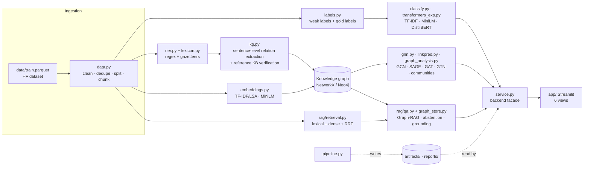

# Technical architecture

## Layers and responsibilities

| Layer | Modules | Responsibility | Depends on |
|---|---|---|---|
| Configuration | `config.toml`, `cyberintel/config.py` | all paths and hyper-parameters; no hard-coded path in code | – |
| Data ingestion & preprocessing | `data.py`, `textutil.py`, `preprocessing.py` | load, clean (sentence-level removal of leaked reasoning), dedupe, **one stratified split**, chunking; NLTK tokenisation/stemming/lemmatisation/POS (AA3) | config |
| Labels | `labels.py` | taxonomy, weak labels (keyword rules), gold-label loader | data |
| NER | `ner.py`, `lexicon.py` | 15 entity types, normalisation, offsets, entity-level evaluation | – |
| Knowledge graph | `kg.py`, `resources/kb.json` | sentence-level relation extraction, support/lift/evidence, KB verification, graph build | ner |
| Graph analysis & ML | `graph_analysis.py`, `gnn.py`, `linkpred.py` | statistics, Louvain communities, PageRank, exports; GCN/SAGE/GAT/GTN; link prediction | kg |
| Classification | `classify.py`, `transformers_exp.py` | classical models, preprocessing ablation, Transformer experiments, weak + gold evaluation | labels, embeddings |
| Retrieval | `rag/retrieval.py` | chunk index: TF-IDF (full vocabulary) + dense + Reciprocal Rank Fusion | data, embeddings |
| Graph access | `rag/graph_store.py` | `GraphStore` interface; `NetworkXStore` (default) and `Neo4jStore` (Cypher) | kg |
| QA | `rag/qa.py` | entity linking, intent routing, graph facts, abstention gate, generator (extractive / Claude), grounding check | retrieval, graph_store |
| Evaluation | `rag/evaluation.py`, stage code | P@k, R@k, MRR, answer correctness, abstention, grounding; bootstrap CIs | qa |
| Orchestration | `pipeline.py`, `pipeline_stages.py` | stages `corpus ner topics classify kg rag_index gnn linkpred qa_eval` → `artifacts/`, `reports/` | all |
| Backend | `service.py` | the only API the UI uses: overview, analyse, search, profile, subgraph, answer, compare, reports | artifacts |
| Frontend | `app/main.py`, `app/ui.py`, `app/views/*.py` | Streamlit multi-page UI; no computation beyond display | service |

## Design decisions in one place (the "why")

1. **Pipeline writes, UI reads.** Heavy work (NER, graph, GNN training, indexing) runs once offline; the UI starts in seconds from cached artifacts and shows only numbers that exist in `reports/`. This is also what makes the UI honest: no widget can display a figure that was not computed.
2. **In-process service instead of a REST API.** The UI and the evaluation both call `CyberIntelService`. A web API (FastAPI) would add a dependency and a network hop without adding any course-relevant capability; the service layer keeps the same separation (and a FastAPI wrapper would be ~30 lines).
3. **`GraphStore` interface.** Course Chap. 4 requires Neo4j; the lab machine could not run it. The interface lets the same QA code run on the in-memory graph (tested) and on Neo4j (Cypher, with a self-check script).
4. **Streamlit** for the UI: Python-only, supports the data-science widgets needed (tables, charts, chat, graph embedding), and the course is Python-based.
5. **Pure-torch GNNs.** No `torch_geometric`: at 2.2k nodes the layers are short, every line can be explained, and installation on Windows/Python 3.13 is not a risk.
6. **Extractive generation by default.** The answer is assembled only from retrieved facts and sentences, so it cannot hallucinate and every claim can be machine-checked (`verify_grounding`). Claude generation is available but optional.
7. **One split for everything**, stored in the corpus (`split` column) and stratified by weak label; unsupervised vectorisers are fitted on train only inside experiments.

## Reproducibility

`python -m cyberintel.pipeline all` is deterministic given `config.toml` (seed 42; GNN seeds 0–4). Transformer experiments (`transformers_exp.py`) are seeded but CPU run time and tiny floating-point differences across machines can change the last decimal.
